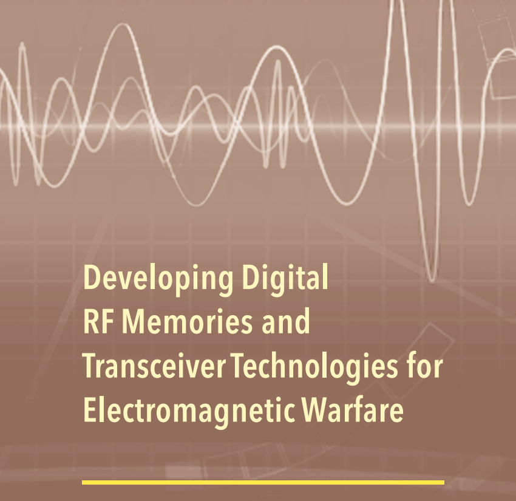
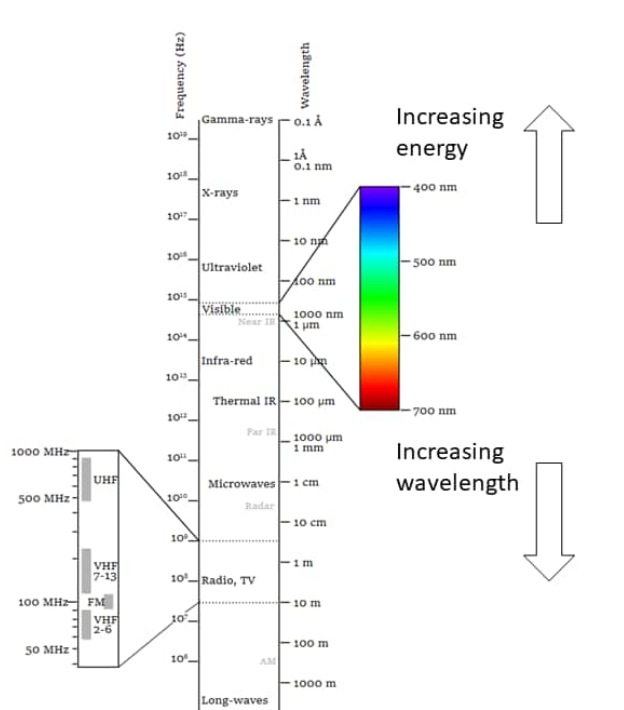
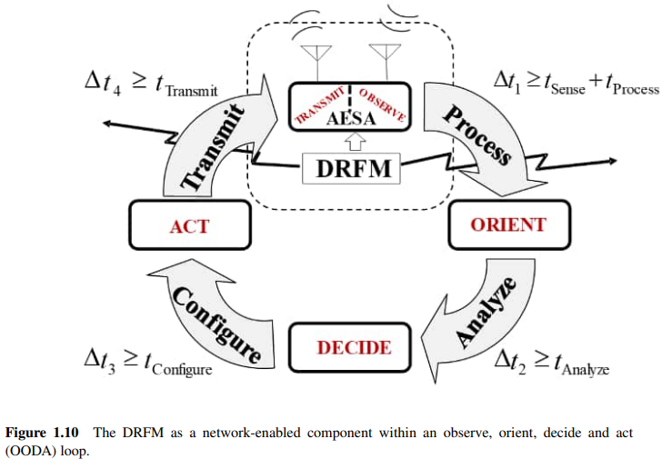
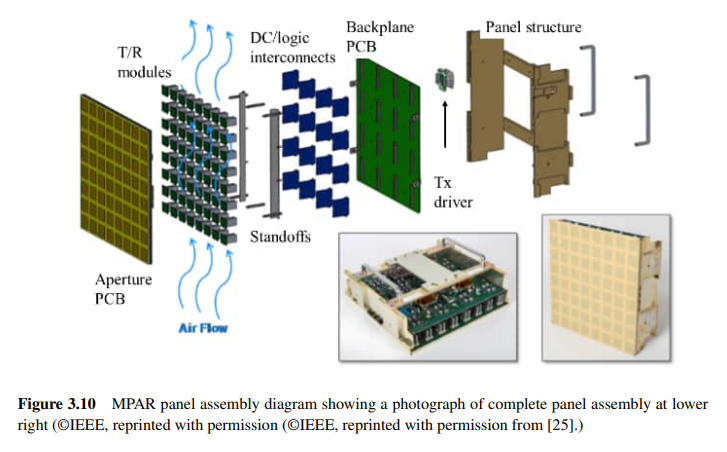
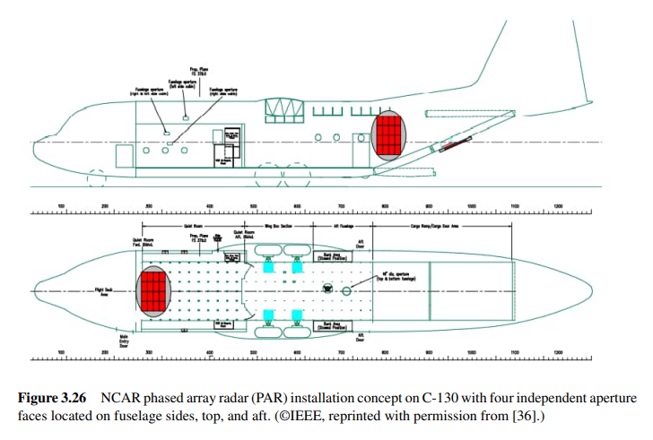
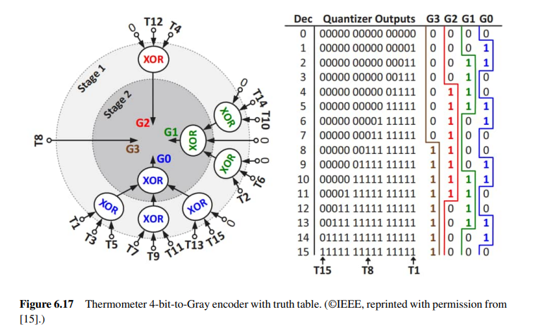

# The Core Engine of Modern Electromagnetic Warfare - A Deep Analysis of "Developing Digital RF Memories and Transcei"

🌟 The core engine of modern electromagnetic warfare - A deep analysis of "Developing Digital RF Memories and Transceiver Technologies for Electromagnetic Warfare"
In today's rapidly changing electromagnetic battlefield, whoever controls the spectrum, controls the initiative on the battlefield. One key equipment to achieve electromagnetic spectrum dominance is digital radio frequency memories (DRFM) and the high-performance transceiver technology behind them.
Today, we highly recommend a hardcore technical monograph written by an internationally renowned expert in electromagnetic warfare, Professor Philip E. Pace:
📚 "Developing Digital RF Memories and Transceiver Technologies for Electromagnetic Warfare"
This book is not only the fruit of decades of research and teaching by the author but also a complete guide from theory, architecture to engineering practice, covering the latest technological trends in DRFM and its supporting transceivers - including broadband spectrum perception, active phased array antennas, photonic RF, and the application of AI/Machine Learning in electronic warfare.
📗 Why must you understand DRFM? In modern electromagnetic combat (EMW), DRFM has long been more than just a simple signal "recording - replaying" device; it has become the central hub of networked, intelligent, multifunctional electromagnetic warfare systems. Professor Pace clearly points out in the book that the role of DRFM has expanded to:
🔍 Electronic Support (ES): Broadband signal interception, modulation recognition, individual radiation source identification;
⚡ Electronic Attack (EA): High-fidelity pseudo target generation, distance/speed waveband dragging, and phase-coherent jamming interference;
🛡 Electronic Protection (EP): Anti-DRFM Jamming Techniques, signal diversity and orthogonal coding countermeasures. Especially in scenarios such as unmanned platforms, miniaturized decoys, and distributed collaborative operations, low SWaP, high-performance DRFM transceivers have become key equipment for determining electromagnetic superiority.
📚 What makes this book unique? 1️⃣ "From discrete components to system-level thinking" - The golden architecture of the entire book is divided into two parts, with a very clear structure:
The first part: Spectrum perception, architecture, and practice. Starting from the concept of electromagnetic spectrum advantages, it deeply explains various DRFM receiver architectures (superheterodyne, phase sampling, channelization), AESA antennas and beamforming, broadband receiver selection (compressive sensing, Nyquist folded receiver), mathematical modeling of transceivers, ADC/DAC nonlinear and spurious analysis, until high-speed comparators, time interleaving, FinFET, photonic transceivers and other cutting-edge device technologies.
The second part: Modern ES and EA Technologies Based on Deep Learning - This is one of the biggest highlights of the book! The author systematically elaborates on how to use AI/ML/DL to enhance electromagnetic perception and attack capabilities: including using CNN, LSTM, autoencoders for radiation source modulation recognition, PRI analysis, unknown radiation source open set identification; using deep reinforcement learning to achieve drone autonomous navigation and cognitive electromagnetic attacks; using generative adversarial networks (GAN) to generate highly realistic pseudo-jamming interference; and even detailed introductions to how digital image synthesizers (DIS) can generate structurally fake targets images for SAR/ISAR.
2️⃣ Engineering-oriented, detail-rich. The book not only talks about "what", but also "why" and "how". You can see:
Quantitative noise, spurious detailed calculations;
ADC/DAC transfer functions, nonlinear analysis;
Photonic ADC timing jitter quantum limit;
The DRFM (Digital Radio Frequency Modulation) false target full-digital synthesis pipeline architecture, including phase increments, gain coefficients, and overflow management;
Countermeasures against DRFM technology through statistical detection (Neyman-Pearson, GLRT) and LSTM recognition distance wavefront guidance.
These contents directly address the practical needs of system designers, electronic warfare engineers, and university research scientists.
3️⃣ Complementary MATLAB code aids in scientific research and teaching. The official website provides a runnable MATLAB software package that can reproduce a large number of simulation results from the book (such as Wigner-Ville time-frequency analysis, QMFB subband decomposition, circularly stable spectrum correlation, etc.), making it extremely convenient for classroom teaching or algorithm prototype verification.
🎯 Which readers are most suited for this book? Electronic warfare / radar system engineers: Needs for DRFM transceiver design, development of interference waveforms;
AI+EMW researchers: To explore the application of deep learning in spectrum perception, radiation source classification, intelligent jamming;
Military communication and radar countermeasures graduate students: As a system-level textbook or reference topic;
Defense science and technology managers: To grasp the technological pulse of electromagnetic warfare equipment, supporting project demonstration.
💡 List of capabilities you will acquire from reading this book (partial list)
1. Designing DRFM transceiver channels meeting specific ultra-wideband, high dynamic range requirements;
2.
Mastering the selection and implementation key points of advanced receiver architectures such as compression sense, photonic reception, channelization;
3.
Using machine learning and deep learning to build automatic modulation recognition, unknown radiation source classification, and decoy jamming generation systems;
4.
Understanding the selection and performance trade-offs of AESA antennas, GaN/SiGe T/R modules, high-speed ADC/DAC;
5.
Designing and evaluating RGPO/VGPO, SAR/ISAR false targets, advanced electronic attack technologies from a signal processing perspective;
6.
Insight into the weaknesses of DRFM and designing effective electronic protection measures.
🛒 Book Information: Title: "Developing Digital RF Memories and Transceiver Technologies for Electromagnetic Warfare"
🧠 Conclusion In today's era where algorithmic integration with hardware is deeply integrated, and intelligent electromagnetic warfare accelerates its evolution, Professor Pace's book is not only a reference tool but also a bridge connecting fundamental theories, advanced technologies, practical applications, and future trends. Whether you are at the forefront of research and development or dedicated to academic breakthroughs, it will become an indispensable weapon in your armory for adopting a "spectrum-winning" mindset.

## Images

<!-- PAYMENT_BLOCK -->

## Get this dataset

- Payment link (Stripe): [Buy now](https://buy.stripe.com/3cs8yP7sY87d0vu9AB)
- Payment QR code: 

<!-- /PAYMENT_BLOCK -->
